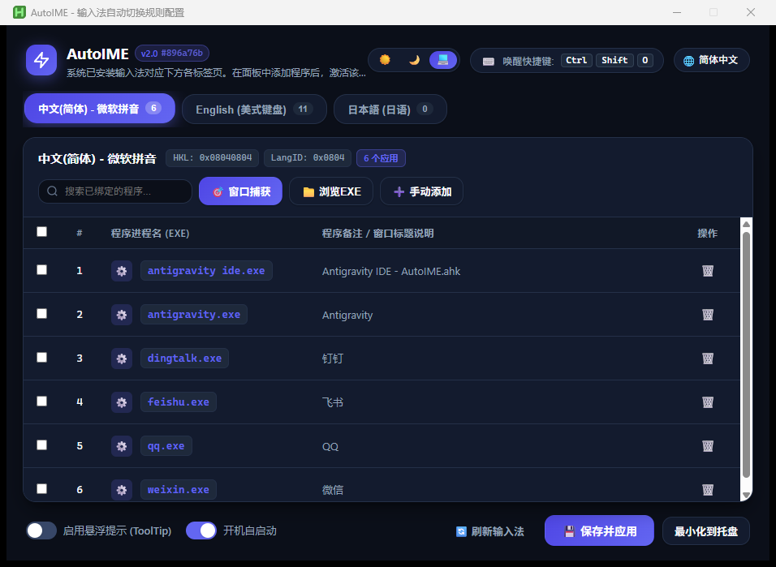

# AutoIME

A modern Windows Input Method (IME) and Keyboard Layout automatic switcher built with AutoHotkey v2, Microsoft Edge WebView2, and React.

[ English | [简体中文](README_zh.md) | [日本語](README_ja.md) ]

[](https://www.autohotkey.com/)
[](https://react.dev/)
[](https://microsoft.com/windows)
[](LICENSE)

---

## Overview

AutoIME is a background desktop utility for Windows that automatically activates the appropriate Input Method (IME) or keyboard layout depending on the currently focused foreground window. Powered by Win32 global event hooks (`SetWinEventHook`), it provides instant zero-polling response without battery or CPU drain.

The user interface has been completely refactored with **Microsoft Edge WebView2** and **React 19**, offering a modern Fluent design with light mode, dark mode, and system theme synchronization.

## Preview

| Dark Mode | Light Mode |
| :---: | :---: |
|  |  |

---

## Features

- **Per-Process Automatic Switching**: Automatically switch to your preferred IME layout as soon as an application gains focus.
- **Modern React & WebView2 UI**: Fully offline, standalone bundle with gentle multi-layered shadows and rounded cards.
- **3-State Theme System**: Light Mode (`☀️`), Dark Mode (`🌙`), and Follow System (`💻`) that reacts to Windows OS theme changes in real time.
- **Git Commit Hash Versioning & Online Updater**:
  - Version tags are automatically extracted from GitHub short commit hashes (e.g., `v2.0 #896a76b`).
  - One-click online update checking and in-app automated updating while preserving your custom `AutoIME_config.ini`.
- **Dynamic IME Enumeration**: Automatically detects all installed system keyboards and language packs.
- **Target Window Capture Mode**: Point and click at any window to instantly register an application rule.
- **Interactive Hotkey Recorder**: Capture physical keystrokes (`Ctrl`, `Alt`, `Shift`, `Win` + any key) to set global activation hotkeys.
- **Batch Management**: Search filter, select-all checkboxes, batch deletion, and single-click tab clearing.
- **Multi-language Support**: English, Simplified Chinese, and Japanese included out of the box.
- **GitHub Actions CI/CD**: Automatic packaging into lightweight release zips (containing only necessary runtime files) on every commit.

---

## Getting Started

### Method 1: Ready-to-Use Zip (Recommended)

1. Download the latest `AutoIME-<commit-hash>.zip` from GitHub Releases or Actions artifacts.
2. Extract the archive and double-click `AutoIME.ahk` to launch.

### Method 2: Run from Source

1. Clone repository:
   ```bash
   git clone https://github.com/kyuuseiryuu/AutoIME.git
   cd AutoIME
   ```
2. Install dependencies & fetch WebView2Loader DLL:
   ```bash
   npm install
   ```
3. Build the React bundle:
   ```bash
   npm run build
   ```
4. Run `AutoIME.ahk` with [AutoHotkey v2](https://www.autohotkey.com/).

---

## Usage Guide

1. **Open Settings**: Press <kbd>Ctrl</kbd> + <kbd>Alt</kbd> + <kbd>I</kbd> or double-click the system tray icon.
2. **Add Application Rules**:
   - Select the target IME tab.
   - Click **🎯 Capture Window** and click on any target application, or click **📁 Browse EXE** / **➕ Manual Add**.
   - Click **💾 Save & Apply**.
3. **Change Themes**: Click `☀️` (Light), `🌙` (Dark), or `💻` (Follow System) in the top-right header.
4. **Check for Updates**: Click on the version badge (e.g. `v2.0 #896a76b`) in the header or right-click the tray icon and select **🔄 Check for Updates...**.

---

## License

This project is licensed under the [MIT License](LICENSE).
