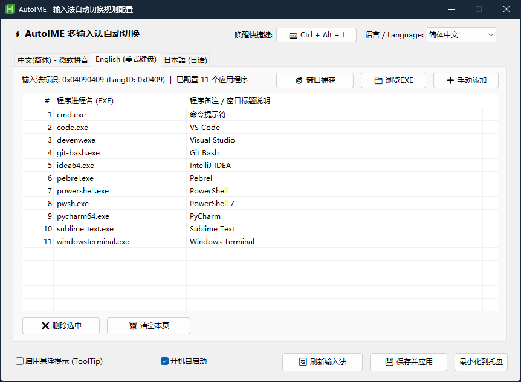
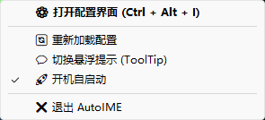

# AutoIME

AutoHotkey v2 による Windows 向け入力方式（IME）およびキーボードレイアウト自動切替ツール。

[ [English](README.md) | [简体中文](README_zh.md) | 日本語 ]

[](https://www.autohotkey.com/)
[](https://microsoft.com/windows)
[](LICENSE)

---

## 概要

AutoIME は、アクティブウィンドウのフォーカス変更を検知し、アプリケーションごとに割り当てられた入力方式（IME）またはキーボードレイアウトへ自動的に切り替える Windows 向け常駐ツールです。Win32 グローバルイベントフック（`SetWinEventHook`）により前台ウィンドウのアクティブ化イベントをリアルタイムに検知（周期ポーリング不要・0ms 瞬時応答・待機時 CPU 0%）し、登録されたプロセスに合致した場合に該当の入力方式へ即座に切り替えます。

## スクリーンショット

### 設定画面



### タスクトレイメニュー



## 主な機能

- **プロセス単位のレイアウト切替**：指定したプロセスがアクティブになった際、紐付けられた IME またはキーボードレイアウトへ自動切替。
- **システムレイアウトの動的取得**：Win32 API およびレジストリからインストール済みの入力方式・キーボードレイアウトを自動抽出し、レイアウト別の設定タブを動的に生成。
- **ウィンドウ取得モード**：マウスポインタ直下のウィンドウからプロセス名およびウィンドウタイトルをリアルタイムで取得し、クリックまたは確認キーでルールへ直接登録可能。
- **インタラクティブなホットキー設定**：物理キーボードの押下を検出する設定ダイアログにより、任意のキーの組み合わせ（`Ctrl`、`Alt`、`Shift`、`Win` ＋ 任意のキー）で起動ショートカットキーを指定可能（既定値: `Ctrl+Alt+I`）。
- **3言語対応と容易な拡張性**：英語、簡体字中国語、日本語に対応。言語定義は `lang/*.ini` ファイルとして独立管理されており、組み込みの英語フォールバックを備えています。スクリプト本体の改変なしに新たな言語パックを追加可能（詳細は [多言語設定ガイド](lang/README.md) を参照）。
- **タスクトレイ常駐**：システムトレイに格納され、設定画面の表示、設定の再読み込み、切替通知（ToolTip）のオン／オフ、自動起動の状態切り替え、GitHub からの最新版取得、およびワンクリックでのプログラム再起動に対応。
- **スタートアップ登録**：Windows のスタートアップディレクトリ（`shell:startup`）へのショートカット作成／削除により自動起動を制御。レジストリの改変は行いません。
- **ルールの競合処理**：すでに他の入力方式に登録されているプロセスを追加しようとした場合、確認ダイアログを表示してワンクリックでの移動に対応。

## 動作要件

- **対応OS**：Windows 10 / Windows 11（64ビット／32ビット）
- **ランタイム**：[AutoHotkey v2.0+](https://www.autohotkey.com/)（スクリプト直接実行時のみ必要）

## インストールと実行

### スクリプトの直接実行

1. リポジトリをクローンまたはダウンロードします：
   ```bash
   git clone https://github.com/kyuuseiryuu/AutoIME.git
   cd AutoIME
   ```
2. AutoHotkey v2 がインストールされた環境で `AutoIME.ahk` を実行します。

### 実行ファイル (EXE) へのコンパイル

AutoHotkey 未導入の環境で動作させる場合：
1. AutoHotkey 付属のコンパイラ `Ahk2Exe` を起動します。
2. **Source (script)** に `AutoIME.ahk` を指定します。
3. **Destination (.exe)** に出力先（例: `AutoIME.exe`）を指定します。
4. **Base File** に `AutoHotkey64.exe` (v2) を選択します。
5. **Convert** をクリックして実行可能ファイルを生成します。

## 使い方

### プロセスルールの登録

1. <kbd>Ctrl</kbd> + <kbd>Alt</kbd> + <kbd>I</kbd> を押すか、タスクトレイアイコンをダブルクリックして設定画面を開きます。
2. 対象とする入力方式のタブを選択します。
3. 以下のいずれかの方法でプロセスを追加します：
   - **ウィンドウ取得**：【🎯 ウィンドウ取得】をクリックし、対象アプリケーションのウィンドウにマウスを合わせて左クリック（または <kbd>Space</kbd> / <kbd>Enter</kbd> / <kbd>F8</kbd>）。キャンセルは <kbd>Esc</kbd>。
   - **EXEを参照**：【📁 EXEを参照】をクリックし、ファイル選択画面から実行ファイルを選択。
   - **手動追加**：【➕ 手動追加】をクリックし、プロセス名（例: `code.exe`）を直接入力。
4. 【💾 保存して適用】をクリックして設定を保存します。

### 主な操作一覧

| 操作 / ショートカット | 機能 |
| :--- | :--- |
| <kbd>Ctrl</kbd> + <kbd>Alt</kbd> + <kbd>I</kbd> | 設定画面の表示／非表示（カスタマイズ可能） |
| トレイアイコンのダブルクリック | 設定画面を表示 |
| キャプチャ中に <kbd>Esc</kbd> | ウィンドウ取得モードを終了 |
| キャプチャ中に <kbd>Space</kbd> / <kbd>Enter</kbd> / <kbd>F8</kbd> | ホバー中のウィンドウをルールとして追加 |

## 設定ファイル仕様

設定はスクリプトと同じディレクトリにある `AutoIME_config.ini`（UTF-16 LE）に保存されます。ファイルが存在しない場合、初回起動時に既定値と初期ルールが自動生成されます。

```ini
[Settings]
DebugMode=0        ; 0: 通知無効 | 1: 切替時に ToolTip で通知表示
Language=ja        ; 言語: ja (日本語) | en (英語) | zh (中国語)
Hotkey=^!i         ; 起動キー仕様 (^=Ctrl, !=Alt, +=Shift, #=Win)

[IME_0x04110411]   ; 入力方式の HKL 識別子 (例: 日本語)
DisplayName=日本語 (Japanese)
slack.exe=Slack
line.exe=LINE

[IME_0x04090409]   ; 入力方式の HKL 識別子 (例: 英語・米国)
DisplayName=English (United States) - US
code.exe=Visual Studio Code
windowsterminal.exe=Windows Terminal
```

設定テンプレートは [`AutoIME_config.example.ini`](AutoIME_config.example.ini) を参照してください。

## プロジェクト構成

```text
AutoIME/
├── screenshots/
│   ├── ui-config.png             # 設定画面スクリーンショット
│   └── ui-tray.png               # タスクトレイメニュースクリーンショット
├── lang/
│   ├── README.md                 # 多言語設定・ローカライズガイド
│   ├── en.ini                    # 英語言語ファイル
│   ├── ja.ini                    # 日本語言語ファイル
│   └── zh.ini                    # 中国語言語ファイル
├── AutoIME.ahk                   # メイン AutoHotkey v2 スクリプト
├── AutoIME_config.example.ini    # 設定テンプレート
├── LICENSE                       # MIT ライセンス
├── README.md                     # プロジェクトドキュメント (英語・既定)
├── README_ja.md                  # プロジェクトドキュメント (日本語)
└── README_zh.md                  # プロジェクトドキュメント (中国語)
```

## 技術仕様と注意点

- **イベント駆動型フック**：Win32 ネイティブイベントフック（`SetWinEventHook` による `EVENT_SYSTEM_FOREGROUND = 0x0003` 監視）を採用。定期タイマーによるポーリングを排除し、待機時 CPU 使用率 0% および瞬時切替を実現しています。
- **切替制御**：対象ウィンドウハンドルに対し、`PostMessageW` で `WM_INPUTLANGCHANGEREQUEST`（メッセージ番号 `0x0050`）を送信します。日本語（`0x0411`）、簡体字中国語（`0x0804`）および英語（`0x0409`）などの特定の入力方式においては、IMM32 API（`ImmGetDefaultIMEWnd`、`0x0283`）を用いて入力変換状態の開閉を制御します。
- **権限境界 (UIPI)**：Windows の UIPI（ユーザインターフェース特権分離）により、通常権限のプロセスから管理者権限で実行されているウィンドウに対してメッセージを送信することはできません。管理者権限のアプリケーションに対しても切替を行う必要がある場合は、AutoIME を管理者として実行してください。

## ライセンス

本プロジェクトは [MIT License](LICENSE) のもとで公開されています。

