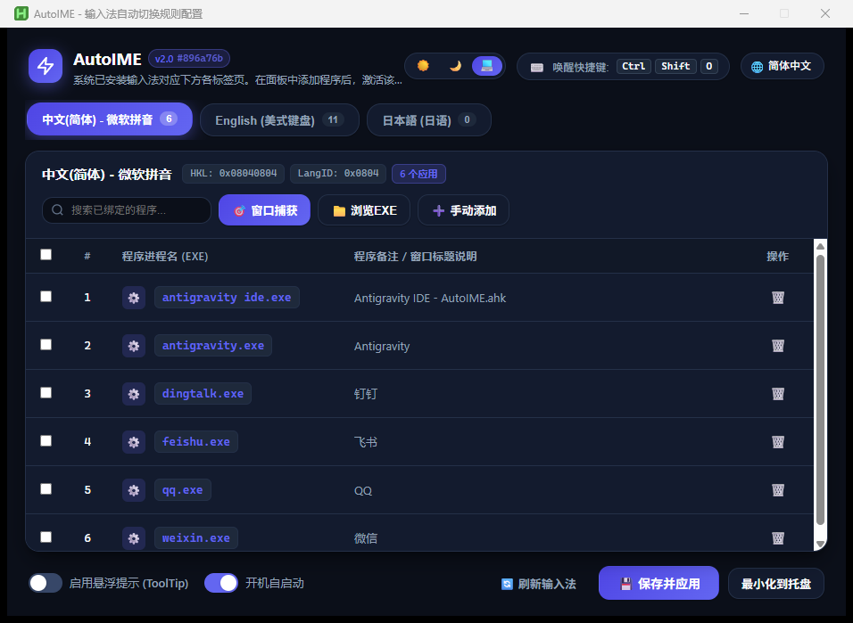
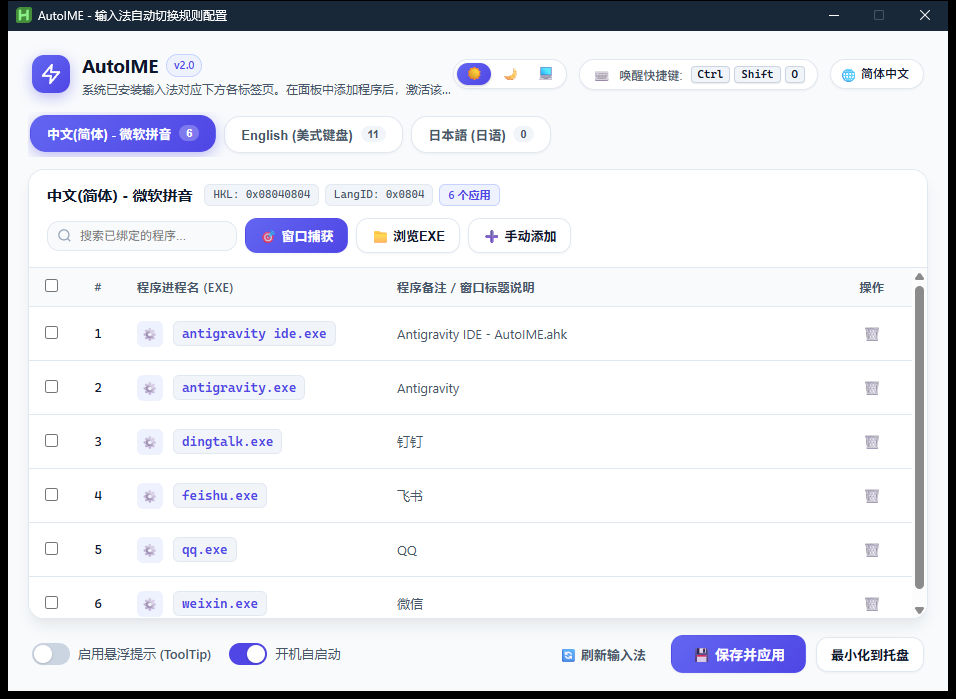

# AutoIME

基于 AutoHotkey v2 + WebView2 + React 构建的现代化 Windows 输入法与键盘布局自动切换工具。

[ [English](README.md) | 简体中文 | [日本語](README_ja.md) ]

[](https://www.autohotkey.com/)
[](https://react.dev/)
[](https://microsoft.com/windows)
[](LICENSE)

---

## 概述

AutoIME 是一个运行于 Windows 平台的后台智能辅助工具，能够根据当前前台活动窗口自动切换对应的输入法（IME）或键盘布局。程序通过 Win32 全局事件钩子（`SetWinEventHook`）实时响应系统前台窗口激活事件（零周期轮询唤醒、零延迟瞬时生效），并在检测到匹配规则的进程时，调用底层 IMM32 接口将输入法无缝切换至目标状态。

界面部分基于 **Microsoft Edge WebView2** 与 **React 19** 全新重构，兼具桌面级原生性能与现代 Fluent 视觉体验，支持浅色、深色及跟随系统外观。

## 界面预览

| 深色模式 (Dark Mode) | 浅色模式 (Light Mode) |
| :---: | :---: |
|  |  |

---

## 功能特性

- **进程级别自动切换**：目标程序获得前台焦点时，自动切换至配置的输入法或键盘布局。
- **现代化 React 界面**：基于 Microsoft Edge WebView2，纯本地打包离线运行，具备圆角卡片、柔和多层阴影与微动效。
- **三态主题切换**：支持 ☀️ 浅色模式、🌙 深色模式与 💻 跟随系统（实时响应 Windows 系统深浅色外观变化）。
- **版本号截取与在线更新**：
  - 版本号与构建包基于 GitHub Short Commit Hash 自动截取标记（如 `v2.0 #896a76b`）。
  - 支持**一键检查更新与静默在线更新**，自动下载最新版本并无缝覆盖（永久保留用户的 `AutoIME_config.ini` 配置）。
- **系统布局动态枚举**：通过 Win32 API 与注册表读取当前系统已安装的键盘布局和输入法，自动生成对应的配置标签页。
- **窗口捕获模式**：点击【🎯 窗口捕获】后指向任意窗口，单击左键或按快捷键即可一键绑定规则。
- **按键录制配置**：内置快捷键设置弹窗，实时监听物理键盘组合输入（支持 `Ctrl`、`Alt`、`Shift`、`Win` 与任意按键）。
- **规则多选与批量操作**：支持按进程名模糊搜索、多选批量删除及清空当前列表。
- **多语言原生支持**：支持简体中文、英文与日语，可在界面中直接切换。
- **系统托盘集成**：支持最小化至系统托盘常驻运行，托盘右键菜单提供配置打开、重载、通知切换、开机自启管理、在线更新及重启。
- **GitHub Actions CI 持续集成**：每次 push 提交自动触发自动化打包，仅提取运行时必需文件生成精简独立的 Release zip 包。

---

## 运行环境

- **操作系统**：Windows 10 / Windows 11（64 位推荐，同时支持 32 位）
- **运行环境**：
  - [AutoHotkey v2.0+](https://www.autohotkey.com/)
  - Microsoft Edge WebView2 Runtime（Windows 10 现代版本及 Windows 11 已系统自带）

---

## 下载与运行

### 方式一：下载开箱即用发布包 (推荐)

1. 前往 GitHub Releases 或 Actions 页面下载最新的 `AutoIME-<commit-hash>.zip`。
2. 解压至任意文件夹，双击运行 `AutoIME.ahk` 即可启动。

### 方式二：从源码运行与二次开发

1. 克隆代码仓库：
   ```bash
   git clone https://github.com/kyuuseiryuu/AutoIME.git
   cd AutoIME
   ```
2. 安装前端构建依赖：
   ```bash
   npm install
   ```
   > `npm install` 会自动执行 `download-dll.js`，自动从官方 NuGet 包下载所需的 `WebView2Loader.dll`。

3. 编译前端资源包：
   ```bash
   npm run build
   ```
   > 使用 esbuild 将 React 组件树一键打包为 `ui/html/app.bundle.js`，无外部网络依赖。

4. 运行主脚本：
   双击 `AutoIME.ahk` 启动程序。

---

## 使用指南

### 1. 唤醒配置窗口
- 默认唤醒快捷键：<kbd>Ctrl</kbd> + <kbd>Alt</kbd> + <kbd>I</kbd>（可在界面或托盘中自定义）。
- 双击系统托盘右下角的 AutoIME 图标。

### 2. 绑定程序与输入法规则
1. 切换至顶部对应的输入法标签页（如【微软拼音】或【English】）。
2. 添加规则的三种方式：
   - **🎯 窗口捕获**：点击后鼠标变为十字靶心，移动到目标软件窗口上方单击鼠标左键（或按 <kbd>Space</kbd> / <kbd>Enter</kbd>）即可捕获；按 <kbd>Esc</kbd> 退出捕获。
   - **📁 浏览EXE**：通过文件管理器选择 `.exe` 可执行文件。
   - **➕ 手动添加**：手动输入进程名称（支持自动补齐 `.exe` 后缀）与备注。
3. 点击右下角【💾 保存并应用】即可立即生效。

### 3. 外观主题切换
点击右上角三态分段按钮切换界面主题：
- `☀️` 浅色模式
- `🌙` 深色模式
- `💻` 跟随系统（随 Windows 主题实时自动适应）

### 4. 检查更新与在线更新
- **界面更新**：直接点击标题栏旁边的版本药丸徽章（如 `v2.0 #896a76b`），程序将自动联网比对 GitHub 最新发布与 Commit，发现新版本时弹出更新对话框，点击【立即更新】即可全自动静默升级并重启。
- **托盘更新**：右键系统托盘图标，选择【🔄 检查更新...】。

---

## 配置文件说明

所有配置均持久化保存在脚本同级目录下的 `AutoIME_config.ini` 中：

```ini
[Settings]
DebugMode=0        ; 0: 关闭提示 | 1: 切换窗口时右下角弹出 ToolTip 提示
Language=zh        ; 界面语言: zh (中文) | en (英文) | ja (日文)
Hotkey=^!i         ; 唤醒快捷键 (^=Ctrl, !=Alt, +=Shift, #=Win)
Theme=system       ; 外观主题: system (跟随系统) | light (浅色) | dark (深色)

[IME_0x08040804]   ; 微软拼音输入法 HKL 标识
DisplayName=中文(简体) - 微软拼音
weixin.exe=微信
qq.exe=QQ

[IME_0x04090409]   ; 英文键盘 HKL 标识
DisplayName=English (美式键盘)
code.exe=VS Code
windowsterminal.exe=Windows Terminal
```

---

## 许可证

本项目基于 [MIT License](LICENSE) 开源发布。
